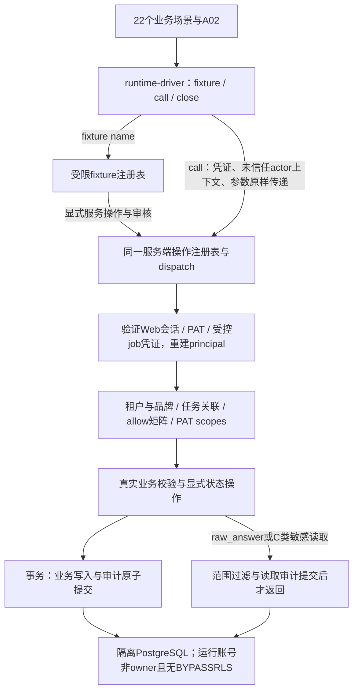

# GEO 产品 · 开发任务切片（backlog v1.0）

> 用法：agent 按 §8 工作流认领；每个任务的完成定义（DoD）= 所引文档章节的实现 + 所列测试全绿 + 人审 diff。
> 粒度原则：一个任务 ≈ 一个会话能完成并自验。状态：`todo / doing / review / done`。

## 切片 0 · 骨架（先于一切功能）

| ID | 任务 | 依赖 | 完成定义（DoD） |
|---|---|---|---|
| T01 | 定稿 AGENTS.md（拍板技术栈、目录约定） | — | §2 各【待拍板】全部填实；人签字 |
| T02 | 产出 `api-spec.md`：API 契约 + 状态机 | T01 | 按 `api-spec-template.md` 结构产出全量条目；人审后冻结 |
| T03 | 硬规则测试清单落地 | T02 | 产品文档 §19 当前实际 19 条规则（原18为历史计数）每条至少 1 个测试用例进 `tests/rules`，可全部跑红；架构测试 2 条（无直写库路径、服务端权限全覆盖） |
| T04 | 数据库迁移：29 张表（§18当前数） | T01 | §18 全部表 + 字段 + 注释建成；迁移可重复执行；fixture 能载入"简造 ERP"种子数据；C4记账：official_fact可选product_line_ref，MVP单品牌可空，随T04定稿迁移（不阻塞） |
| T05 | 多租户与服务端权限 | T04 | `tenant_id` 行级隔离中间件；§9.3 权限矩阵做成服务端策略表；越权请求测试全红→绿 |
| T06 | 审计中间件 | T04 | 所有写操作 + 原始回答/C 类数据访问写 `audit_log`，含 `actor_type/agent_run_id/prompt_version`；漏记测试能抓出 |

## 切片 1 · 词库与探针（对应里程碑第 1–2 周）

| ID | 任务 | 依赖 | DoD |
|---|---|---|---|
| T07 | 种子表 CRUD | T05 | §13.2 ④：维护人 + 复核时间必填（无维护人拒绝保存）；word_type 枚举；版本历史 |
| T08 | 生成语法面板 | T07 | §2 五类模板内置；批量生成预览→确认后入库（带 source_channel） |
| T09 | CSV 导入 `keyword_raw` | T05 | 归一化（大小写/标点/简繁）→ 去重 → 带渠道与 first_seen_at 落库；导入报表（新增/重复/拒绝计数） |
| T10 | 词池批处理 job | T09 | 规则版归簇（共享词根/包含关系）+ 意图打标 + `demand_tier` 分位（P50/P75/P90）+ 周快照 `pool_version+1`；簇 ID 稳定匹配（代表词重叠度，沿用旧 ID）；§10.3 处理段 |
| T11 | 飙升告警 job | T10 | 首见 <14 天且连续两周环比上升 → 通知策略角色；周批内完成 |
| T12 | 问句池管理 | T05 | §3：溯源五字段必填（缺一拒绝）；版本冻结/开新版本；冻结后不可改的测试 |
| T13 | 探针调度器 | T02, T12 | §12.1 三种出场时机（评分批次 / 事件复测 / 月度全量）三套排期逻辑；接入期加急标志 |
| T14 | 模型适配器 | T01 | 4 家模型 API 统一抽象（模型/温度/轮次参数化）；**各家联网参数接入（检索轨/记忆轨双口径，产品文档 §4）**；citation 元数据与正文链接归一化抽取；重试 + 限流 + 配额计数（按 probe 类型）；拒答识别落 `refused` |
| T15 | 探针执行与落库 | T13, T14 | `probe` / `probe_result` 写入；`raw_answer` 存储；配额告警触发 |
| T16 | MVP 判定工作台 | T15 | 先产出 `judging-spec.md`（正则清单 + 品牌词表匹配 + spec_score 规则 + 五类高危）人审冻结；然后实现：四类判定 {0,0.5,1} + 人工修改界面 + 10% 抽检队列 |
| T17 | 评分聚合管道 | T16 | 三层聚合（回答→问句→簇）；`judge_version` 必填；样本不足写 null+insufficient_sample（测试覆盖硬规则 3、4） |
| T18 | 机会看板（内部） | T10, T17 | §13.2 ③：热力图 + 簇列表 + 待补测标记 + 机会卡抽屉；候选双筛（S/A 档 + 真空度）队列 |
| T19 | 机会卡 + 渠道信号 | T18 | 卡生成（demand 字段 + snapshot_id 引用，**不复制分数**）；`cluster_platform_signal` 聚合（模型引用计数 + SERP 占位）；渠道建议合成四层规则 |

## 切片 2 · 生产层（对应里程碑第 3–5 周）

| ID | 任务 | 依赖 | DoD |
|---|---|---|---|
| T20 | 诊断交付台 | T19 | §13.2 ②：结论卡 + 回溯链（点结论→probe_id）+ 3 簇建议大卡 + 导出 PDF；确认/异议动作落库 |
| T21 | 事实块编辑器 | T05 | §13.2 ⑤ + §6：结构化字段；四问校验（不过不给提交）；**必配块类型闸门**（按意图查推导规则表）；段落自包含检查（悬空指代正则）；跨平台口径冲突报警（同 number+unit 不一致） |
| T22 | 来源灯服务 | T21 | L1/L2/L3 判定接口 + 提交侧 L3 拦截；来源 URL 抓取初检（超时/404 标警） |
| T23 | 审核队列 | T21 | **通用 object_type 结构**（§4 约束 5）；diff 视图；驳回必填理由回作者；同人写同人放 → 放行按钮禁用（服务端也拦）；全程 audit |
| T24 | 模板库 + 证据包 | T20 | 按意图六类模板卡片 + 下载；证据包封版（封版后只读）；水印摘录查看器（异议通道专用，无批量导出接口） |
| T25 | 发布登记 + 排期联动 | T23 | §13.2 ⑩：回填时间/URL/平台；登记后自动生成 D+3/D+14/D+30 事件复测排期（喂 T13） |

## 切片 3 · 验证层（对应里程碑第 6–8 周）

| ID | 任务 | 依赖 | DoD |
|---|---|---|---|
| T26 | 复测台 | T15 | §13.2 ⑧：问句×模型×时点矩阵三色格 + 对照组角标 + "不可比"灰条；格子点开看命中 claim_id |
| T27 | 引用判定管道 | T26, T21 | §12.2 四步：品牌词表匹配 → 显式链接抽取（对 content_asset.url，记 cited_domains）→ 指纹匹配（数字+单位+专名）→ 语义兜底（疑似引用进人工抽检）；两级引用分开计数 |
| T28 | 指标快照与差值 | T27 | `metric_snapshot` 聚合（六指标）；差值计算强制校验快照口径，不一致返回 incomparable 不出差值（硬规则 5 测试） |
| T29 | 报告页 | T28 | §13.2 ⑨：月度 SOV/准确率趋势 + 目标簇差值 + 对照组对照 + "内容由我方生产"披露条 + 分母变更标注 + 导出 |
| T30 | 回流信号 job + 工单 | T28 | §8 五类阈值规则扫描 → 工单（信号/证据 probe_id/责任角色/时限，"说错"类 24h 红色）；周一评审队列视图 |
| T31 | e2e 金路径 | 全部 | "简造 ERP"剧本（§10.1 走读示例）做成 fixture + 端到端测试：种子→C-107 冒泡→加急评分→判定→机会卡→诊断→写块→放行→登记→复测→报告差值，全链路一次跑通；fixture必须含已封版brand_lexicon v1（含exclusion）与≥1条approved official_fact；覆盖§13.3十周客户剧本及§13.4六周dogfood：双机会簇→基线T0→登记自动排复测→D+30读数 |
| T32 | 验收映射 | T31 | §14.1 八条验收逐条映射到自动化测试或人工流程清单，输出验收报告模板 |
| T33 | 网页端校准半自动化 | T28 | §4 校准轨：Playwright 辅助复跑月度 5–10% 样本（低频、少量账号、人工复核，**不进主轨**）；偏差率写报告附录；连续两月 <70% 触发口径复核工单 |

## P1 · 内部工具侧（不进外部功能与验收）

| ID | 任务 | 依赖 | 状态 | 完成定义（DoD） |
|---|---|---|---|---|
| T34 | 跨行业情报墙读接口 | T10, T11 | todo | 全租户跨行业聚合只读投影；数据源keyword_pool_snapshot × intent_cluster × 告警表；每行业≤10条新簇/档位环比/告警/竞品新占位信号；仅内部工具，不进外部功能与验收 |
| T35 | 周一digest job | T10 | todo | 周批完成后生成“上周雷达变化”内部摘要对象，落内部表；不经审核队列、不进客户报告；P1内部工具，不进外部验收 |
| T36 | 接入预填job（内部半自动） | T02, T05, T23 | todo | 官网抓取+SERP+LLM起草品牌词表/官方口径草稿供⑫预填确认；每条挂来源URL，采不到输出“需客户提供”清单；人工逐条确认后共用brand_lexicon/official_fact创建链与独立放行人审闸；风险judge_input；仅P1内部工具，不进外部验收，不做自动封版或Agent Runtime |

## 并行业务线（不阻塞开发，阻塞交付）

- B1：B2B 种子词根 50–100 + 竞品词表 + 品牌词表模板（市场侧）
- B2：第一个客户签约（Owner/Editor 名单、C 类授权）
- B3：C 类数据授权合同模板（法务）
- B4：模型 API key / SERP API / 5118 账号采购（**第一天就启动**）
- B5：`keyword_layer_v2.md` 数字复核（阻塞对外引用，不阻塞开发）

## 本次执行记录

- T01：`review`；按用户本次指令扩展为 Next.js App Router + Cloudflare Workers 脚手架、astryx 安装及入口 CSS；原“AGENTS.md 人签字”不由 agent 代办，不修改 AGENTS.md。
- 范围备注：本次仅初始化，不顺带实现数据库、业务 API、Agent/MCP、自动采集或发布功能。

- T02：`doing`；已产出 `docs/api-spec.md` 草案及覆盖测试。三项方向已获用户批准并记录于草案 §1.5；其余问题见 §6。草案合并不代表 T02 完成或整体冻结。

- 本次人审：用户批准事实块审核与发布进度分离、最小职责权限（Admin 不默认读原文）、记忆轨36条参数，并明确授权合并两个PR；T02仍为doing，待其余规格补齐后人审冻结。

## T02 裁定整合与人审冻结候选稿

- T02：`review`（等待人审冻结，未冻结）。三轮裁定原文保存于 `docs/t02-decisions.md`；产品文档仅改§18和授权决策记录行，AGENTS.md未改。
- 交付：`api-spec.md`主规格、`api/contracts.json`生成输入、`api/core-set.md`核心集、`api/permissions.csv`权限规范、`api/states.md`迁移表；支撑件合并至`api/generated/endpoints.md`。
- 31资源（27表+4投影）、112端点、41操作、9角色，共11,439三键权限行；矩阵与字段草案统一随PR人审，不逐行预批。
- 范围备注：不写数据库迁移、不实现业务API/探针调用/判定算法/Agent/MCP/自动发布；这些均留相应后续任务，禁止以规格测试通过代替业务验收。

## T02 冻结前审阅结构整改（R1–R4）

- T02仍为`review`、未冻结：人审主入口改为`docs/spec-map.md`（100行）；先审20项承重动作及全部敏感/配额接口，再审allow集合，支撑件默认抽检。
- API边界31→28、端点112→105、操作41→39；物理表不变。权限原246个allow经归并为230行，另加规则行和列头共232行，不再生成deny行；公式及旧接口归宿见主规格§2与JSON的layout_migration。
- 14项既有检查保持绿，新增2项架构检查；不实现生产鉴权/数据库/探针，不合并或自行冻结规格。

- 文档清理：docs共12个文件，根目录保留6个主文件；API附件集中在api/，53个支撑端点合为1份附录，T01验证记录归档，重复导航/自查报告删除（历史仍可查git）。规则与接口数据不变。

- 逐项审核v4：新增brand_lexicon与official_fact、7端点、15行allow；实际28→30资源、105→112端点、230→245个allow（含规则/列头247行），没有按估计数补造资源。旧批次记录词表版本，官方口径撤回拒绝引用。两项输入契约测试先红后绿；docs仍12文件。只更新当前PR，等待下一条审核意见，未冻结/未合并。

- v3.5走读裁定：落盘开通清单/接入预填、行业管道经营属性、dogfood六周剧本与分发实操；C1配套create/start服务端输入闸门（422 judgment_basis_missing）。P1任务顺延T34–T36，T31强化双剧本及判定基准fixture，C4品线可选字段留T04。当前只改规格、任务与可执行契约示例，不提前实现页面/job或扩大外部验收。

## T03 执行记录（PR #4 合并后）

- T02：`done`。PR #4 已按用户授权合并；随后负责人另行明确批准“同时批准冻结当前 API 规格”，据此记录 t02_api_v1（2026-11-10），内容SHA-256防止无意漂移，后续改动须人审。
- T03：`review`。独立分支 task/t03-rule-tests；19条硬规则对应22个行为验收场景，两项架构检查为A01无直写库、A02实际服务端权限全覆盖。测试映射内嵌 tests/rules/product-rule-cases.mjs 的rule/source/tasks，未另建文档。
- 执行命令：`npm run test:checks`运行已可验证的规格/扫描器/覆盖元检查；`npm run test:product`运行22个业务场景+A02；`npm test`依次运行二者，不能以checks绿色冒充全部验收通过。
- 当前服务层未实现，tests/support/runtime-driver.mjs未接入，23个服务验收检查应明确跑红，不能skip/todo或拿T02示例/假业务实现补齐。该红灯基线符合T03“可全部跑红”的任务定义；T04及后续任务经真实服务层装配数据、逐条转绿。A01为保守源码扫描，不能代替A02真实鉴权验证。
- 不实现T04数据库迁移/seed、不编造judging-spec判定细节、不引入模型调用或Agent Runtime；所有fixture写入未来必须经src/server/api，不准直写库。当前冻结仅据负责人明确授权记录，未改AGENTS.md或产品口径。

## 当前执行状态（T04）

- T03：`done`。用户批准后PR #5已合并，随后新建`task/t04-migrations`，没有在main直接开发。
- T04：`review`。按产品§18实际29表建迁移（初版0001–0003，复核追加0004），另有schema_migration管理账本；原18表是旧计数，四个API投影未另造表。全部字段/列注释由真实PG目录对照§18验证；迁移重复/校验和/失败事务回滚均有集成测试。
- 已落实本轮裁定：seed_list.status允许NULL且无默认、不写枚举值（T07另定）；seed_list/keyword_pool_snapshot/industry_score无tenant_id；keyword_raw非空tenant_id。共享服务限定许可公共词根与数值聚合，拒绝客户标识/竞品私有输入与C类原句，不输出自由文本，不开放未验证样本数的公开基准。
- fixture通过src/server/api显式操作事务装配：虚构简造ERP、独立Strategist/FactCheck/Owner、词表v1含exclusion、L1 approved测试口径及公共种子；每步留审计。C4可选product_line_ref同品牌品线外键已落地。
- T04验证：test:checks 37项通过（含真实PostgreSQL18.6集成）、typecheck、Workers构建、生成器--check；test:product仍为T03既定23项红灯（完整服务驱动尚未接入），不伪造后续业务实现转绿。
- 范围边界：私有表RLS已启用但未放行普通角色，完整租户/角色鉴权留T05、通用审计留T06、种子状态枚举留T07、判定留T16。管理fixture不是公开业务API；未配置线上数据库或运行生产迁移。产品文档仅加四条授权§18注释，AGENTS.md与冻结API附件未改；docs仍12文件。等待人审合并。

- T04复核：pg保留生产依赖，embedded-postgres及@embedded-postgres/*移入生产依赖树；隔离目录npm ci --omit=dev后的13项真实PG检查通过，完整test:checks 37项通过，typecheck/Workers构建/生成器--check通过。机会卡采用英文DB↔冻结中文API显式映射；追加0004兼容迁移，原迁移与冻结规格未改；映射表追加至t02-decisions.md。PR #6待人审，未获新合并授权。

- T05：`review`（仅接线方案）。本轮负责人要求先审runtime-driver接线图，再实现权限与审计中间件；当前不创建driver、不改业务服务。task/t05-wiring-plan基于尚未合并的PR #6修复头，采用堆叠PR，仅包含下列方案。

## T05 接线方案（待负责人审阅，尚未实现）

本轮目标：22个业务场景 + A02 = 23个 product 验收全部转绿；T05同时纳入负责人本轮指定的审计中间件（原T06核心）。这需要权限/审计基础设施及下表业务后端切片，driver本身只做传输。原T07–T29的页面、外部集成及完整任务不据此标done。本方案未改冻结API、判定规则或产品口径。

### 接线图

### 1. fixture注册清单（17名，无通配兜底）

注册表拟置于`tests/support/fixture-registry.mjs`：仅编排`src/server/api`中的服务操作，不含SQL或业务计算；未知fixture名直接失败。隔离库启动/迁移使用管理连接；完成bootstrap后，call只能使用普通运行连接，不能继承管理actor。测试专用身份发行与fixture入口不挂公开路由。

| fixture名称 | 场景 | 服务层准备与返回绑定 |
|---|---|---|
| editable-question | R01 | 私有来源→簇→可编辑问句输入；返回question及Strategist凭证 |
| frozen-question | R01V | 同上→freeze→首次锚定；返回questionId/version，不预改旧行 |
| judged-baseline | R02/R03/R04 | 词表/口径独立放行→配置/问句freeze→batch→录制回答→人工FactCheck标签；返回真实scoreRequest/簇快照身份及baselineJob凭证 |
| comparison | R05/R17/R17V | 通过上述链创建基线/复测；按选项改变配置、只新增其他簇或显式升级锚；返回compareQuery/oldClusterId/oldAnchor |
| seed-input | R06 | 许可公共词根目录及种子输入；不设置未冻结的status枚举 |
| opportunity-input | R07 | 真实簇/来源/版本链→card输入；create仍由被测服务执行 |
| claim-input | R08 | 机会卡→内容资产→claim输入，分派Content任务，来源随输入送校验 |
| pending-claim | R09/R16 | 完整意图必配块→submit→waiting；返回作者及独立FactCheck、同作者审核身份与claimId |
| report | R10 | 我方生产及对照簇经真实批次聚合生成指标，返回metricId；不直接写预期披露字段 |
| archive-transition | R11 | 先聚合→软归档→测试时钟推进89天→同回答再聚合，返回历史/过渡期指标ID |
| public-opportunity | R12 | 由机会卡服务生成并经品牌Owner可读投影返回cardId |
| diagnosis-conclusions | R13 | 实际probe→证据条目/包→通用审核放行→诊断投影，返回reportId |
| snapshot-input | R14 | 返回可用配置输入与CS凭证，judge_version缺失由真实create拒绝 |
| external-answer | R15 | 草稿claim与批次；外部传输回执含恶意文本，只经execute数据路径落库 |
| claim-missing-required-block | R18 | 通过服务创建缺必配块的真实资产/草稿；不伪造submit错误 |
| claim-with-self-containment-error | R18S | 同上且含产品§6已列举字面示例；不在driver生成正则 |
| search-track | R19 | 原生联网能力关闭的测试适配器经配置服务接入，freeze读取能力接口后拒绝 |

共同底座复用T04虚构简造ERP模式：每个场景隔离租户/品牌，词表v1含exclusion、≥1条已生效L1 approved口径、独立写/审人；设置真实品牌/任务关联。返回的ID均对应实际服务资源或服务确定的自然键地址（如尚未append的cluster/snapshot分数地址），不得制造只存在于driver的对象。已知人工标签可作为聚合输入，fixture不计算或填造被测分数/指标。close关闭连接并销毁隔离库，不用业务DELETE绕过不可变约束。

### 2. call()的actor传播

1. fixture返回已登记凭证引用与actor描述；`call(operationId,{actor,params,body,query})`只封装并调用真实dispatch，保留actor_type/agent_run_id/prompt_version及job上下文。null、未知role、跨租户声明、修改actor_type等负例也照送服务端；driver不预判403、不补admin、不换actor、不吞异常成预期成功。
2. server入口从Web会话或PAT校验身份，重新查询当前成员角色、品牌/任务关联、PAT scopes/revoked_at；请求中的actor/role/tid/bid都是未信任声明。身份声明与凭证绑定不一致在服务端403；不能依赖客户端role授权。job由独立受信发行器绑定注册表中的job_name、tenant、trigger_source与batch_id，按端点白名单限制，不能通过body把human改成system。
3. 权限顺序固定：认证→租户→品牌/任务→角色×资源×操作allow→PAT scopes/人工确认/档位限制→状态与业务闸门。所有未知三键默认deny；Admin不能因此读raw_answer；Content/Evidence必须有真实关联任务。读取查询先加范围，再投影，不先取全表再过滤。
4. 校验未信任actor声明只防身份伪造。另加持有效凭证但无资源权限的真实负例，覆盖9角色、同租户跨品牌、未分派任务、diagnosis只读、PAT撤销/限scope、真实external_agent放行拒绝；不能用“伪造声明被拒”冒充权限矩阵验收。Web与PAT走同一策略函数。
5. 每请求BEGIN后服务端设置事务局部租户上下文；普通PG运行角色非owner、无BYPASSRLS，私有表RLS兜底，连接复用不串租户。行业共享表沿用T04公共词根/数值投影边界；不开放未验证≥5租户的公开基准。
6. 响应由服务层形成冻结error体及meta(snapshot_id/data_as_of)，driver仅映射到现有测试协议。机会卡输入/输出在领域边界使用T04双向枚举映射，英文存储码不泄露到API。

### 3. 审计埋点位置

| 位置 | 埋点与原子性 |
|---|---|
| dispatch的写事务包装层 | 所有成功写操作、版本/队列动作、每个受影响对象记audit_log；actor三预留字段始终存在；业务写与审计同事务，审计失败则业务回滚；fixture也经过这层 |
| raw_answer/C类专用查询服务 | 权限/范围通过后，敏感查询与访问审计在同事务提交后才交付数据；普通GET不迁业务状态；调阅记录会话/CS/实际查看人/时间，禁止批量原文出口 |
| 受控job调用同一服务入口 | system审计带注册job名、触发源、对象；探针job必填batch_id，非探针可空；不能以job名跳过权限 |
| 幂等/失败路径 | 24h同键同载荷重放不重复业务审计/计量；每次敏感读取仍审计；拒绝或回滚不能留下“写成功”日志；日志不含token、raw_answer或C原文副本 |

中间件不递归给自身audit INSERT再记审计；对象状态链的每跳由领域服务写入同cause_event_id，同事务提交。PAT last_used_at由服务端凭证元数据路径更新，不能借GET改变业务状态。

### 4. 23项转绿所需的真实服务切片

| 验收 | 必须补齐的服务行为 | 原任务依赖 |
|---|---|---|
| A02 | 单一操作注册表、实际鉴权与自动正/负例；注册表非空且全部为冻结端点 | T05/T06 |
| R01/R01V/R17/R17V | 五溯源、问句freeze/revise/upgrade_anchor、历史只读与簇锚比较 | T12/T28 |
| R02/R03/R04/R14 | 配置必填judge_version、人工标签→问句→簇聚合、样本/覆盖闸门、同配置唯一追加 | T17 |
| R05 | 口径不符422 incomparable，响应无delta | T28 |
| R06/R07/R12 | 维护人闸门、需求档/来源、公共机会卡投影与枚举边界 | T07/T19/T18/T32 |
| R08/R09/R16 | L3拒绝、submit/approve与通用队列原子一致、同人禁令、仅human放行 | T21/T22/T23/T05 |
| R10/R11 | 真实指标聚合、我方生产披露/对照簇、软归档90天分母 | T10/T28/T29 |
| R13 | 每条诊断结论由证据包/探针/来源等级回溯 | T20 |
| R15/R19 | 录制回答通过真实execute落库且不进入指令分发，freeze检查联网能力 | T14/T15/T16 |
| R18/R18S | 意图必配块闸门、仅产品明文两例的自包含校验 | T21/T16 |

这22个场景直接调用22种冻结操作，fixture准备还需对应创建/审核/批次操作；所有真实handler都来自同一注册表。`registeredOperations()`必须直接枚举dispatch注册表，不能手写子集隐藏未鉴权handler。`prepareAuthorizedRequest(id)`以新fixture和真实凭证生成可成功请求，A02先验成功再验403，禁止全局403/空注册表冒充覆盖。

实施顺序：先权限+审计+RLS与凭证测试，再按上表接业务切片和17个fixture，最后运行23场景与全部checks。仅替换外部模型网络传输为录制回答、注入测试时钟；所有业务验证/聚合/状态变更仍在src/server/api。不调用真实探针，不提前宣称T14模型当日联网复核完成，不生成缺失的judge正则/spec_score/指纹阈值；判定输入可使用经FactCheck操作保存的人工标签。若实现触及未冻结判定细则，按AGENTS§3列明再裁定，不能为转绿猜规则。

审核出口：负责人先审本接线方案；获批后才创建runtime-driver和T05中间件。完成时23/23与checks都须绿、无skip/todo/假返回，增加审计故障回滚和真实跨租户/跨品牌/PAT/任务权限回归，分别报告注册端点数与未实现端点；不据局部覆盖声称112端点已全部实现。
