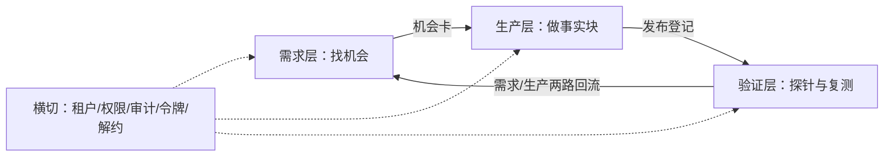
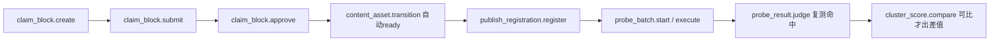

# API 规格审阅地图

> 状态：草案，未冻结。先审本页→[核心集](core-set.md)→[allow权限](t02-permissions.csv)；[支撑件](generated/README.md)默认抽检。

## 三层架构与资源归属

| 层 | API资源（归并后28个，原31个全部有归宿） |
|---|---|
| 需求层 | seed_list、keyword_raw、keyword_pool_snapshot、intent_cluster、question_pool、opportunity_card、scoring_snapshot、cluster_score（内含question_score）、cluster_platform_signal、industry_score、diagnosis_report |
| 生产层 | content_asset、claim_block、review_queue、evidence_package（内含evidence_item）、publish_registration |
| 验证层 | probe_batch（内含probe）、probe_result、metric_snapshot、objection、backflow_ticket |
| 横切支撑 | tenant、brand、user_member、audit_log、api_token、offboarding、deletion_ledger |

仅合并API边界，27张物理表不变；snapshot是配置、batch是执行，簇级问句锚定规则不变。

## 九角色

| 角色 | 职责和范围 |
|---|---|
| owner | 本品牌诊断/报表、full确认优先簇及人工下线；diagnosis仅只读与异议。 |
| editor | 本品牌内容工作台草稿/提交及发布登记；diagnosis禁编辑/登记。 |
| viewer | 本品牌报表/趋势及导出；diagnosis异议申请按矩阵条件。 |
| strategist | 本租户全品牌需求策略、问句锚定、诊断建议；人工决策留痕。 |
| content | 仅分派机会卡/簇/来源关联对象的内容撰写，不能放行。 |
| evidence | 仅任务关联证据包/来源初检；封版须独立FactCheck。 |
| factcheck | 本租户全品牌唯一放行，审核人≠作者；敏感异议升级。 |
| cs | 本租户全品牌复测排期、异议授权与陪同、工单派发。 |
| admin | 配置与审计；原文默认不可读，单次理由调阅+审计。 |

## 20个承重审阅项

组合动作按负责人R4逐接口展开；不是把不同职责压成20个HTTP接口。

| 项 | 审什么 | 完整接口示例 |
|---|---|---|
| 1 | 批次启动与执行 | [probe_batch.start](core-set.md#probe_batchstart) / [probe_batch.execute](core-set.md#probe_batchexecute) |
| 2 | 失败整批补偿 | [probe_batch.compensate](core-set.md#probe_batchcompensate) |
| 3 | 采样配置冻结 | [scoring_snapshot.freeze](core-set.md#scoring_snapshotfreeze) |
| 4 | 问句冻结与锚定升级 | [question_pool.freeze](core-set.md#question_poolfreeze) / [question_pool.upgrade_anchor](core-set.md#question_poolupgrade_anchor) |
| 5 | 簇级出数与不可比 | [cluster_score.read](core-set.md#cluster_scoreread) / [cluster_score.compare](core-set.md#cluster_scorecompare) |
| 6 | 判定写入 | [probe_result.judge](core-set.md#probe_resultjudge) |
| 7 | 块创建 | [claim_block.create](core-set.md#claim_blockcreate) |
| 8 | 块新版本修订 | [claim_block.revise](core-set.md#claim_blockrevise) |
| 9 | 块提交 | [claim_block.submit](core-set.md#claim_blocksubmit) |
| 10 | 块放行 | [claim_block.approve](core-set.md#claim_blockapprove) |
| 11 | 块撤回下线 | [claim_block.retract](core-set.md#claim_blockretract) |
| 12 | 通用队列放行 | [review_queue.approve](core-set.md#review_queueapprove) |
| 13 | 通用队列驳回 | [review_queue.reject](core-set.md#review_queuereject) |
| 14 | 资产三态迁移 | [content_asset.transition](core-set.md#content_assettransition) / [publish_registration.register](core-set.md#publish_registrationregister) / [content_asset.retire](core-set.md#content_assetretire) |
| 15 | 发布登记 | [publish_registration.register](core-set.md#publish_registrationregister) |
| 16 | 诊断原文摘录·异议链 | [diagnosis_report.excerpt](core-set.md#diagnosis_reportexcerpt) |
| 17 | 异议授权 | [objection.grant](core-set.md#objectiongrant) |
| 18 | 异议发起调阅 | [objection.view](core-set.md#objectionview) |
| 19 | 令牌撤销 | [api_token.revoke](core-set.md#api_tokenrevoke) |
| 20 | 回流派单 | [backflow_ticket.assign](core-set.md#backflow_ticketassign) |

## 一个事实块的旅程

[修订](core-set.md#claim_blockrevise)、[撤回下线](core-set.md#claim_blockretract)及同事务链式回退不绕过独立审核。

## 13个状态机索引

| 对象 | 完整迁移表 |
|---|---|
| claim_block | [状态/出边/终态](t02-states.md#claim_block) |
| content_asset | [状态/出边/终态](t02-states.md#content_asset) |
| probe_batch | [状态/出边/终态](t02-states.md#probe_batch) |
| review_queue | [状态/出边/终态](t02-states.md#review_queue) |
| objection | [状态/出边/终态](t02-states.md#objection) |
| backflow_ticket | [状态/出边/终态](t02-states.md#backflow_ticket) |
| evidence_package | [状态/出边/终态](t02-states.md#evidence_package) |
| diagnosis_report | [状态/出边/终态](t02-states.md#diagnosis_report) |
| intent_cluster | [状态/出边/终态](t02-states.md#intent_cluster) |
| question_pool | [状态/出边/终态](t02-states.md#question_pool) |
| scoring_snapshot | [状态/出边/终态](t02-states.md#scoring_snapshot) |
| opportunity_card | [状态/出边/终态](t02-states.md#opportunity_card) |
| publish_registration | [状态/出边/终态](t02-states.md#publish_registration) |

[全局约定](api-spec.md) · [裁定原文](t02-decisions.md) · [归并/行数说明](t02-review.md)；本次不实现API、不合并、不自行冻结。
