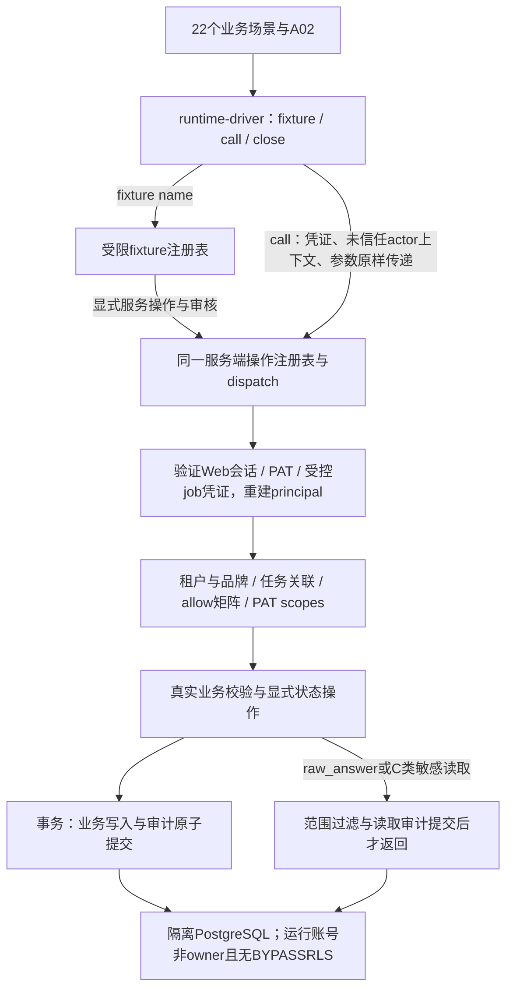

# T05 接线规格附件

状态：负责人批准（2026-11-10）；后续偏离须同步本文与决策记录。

## 接线方案（已批准）

本轮目标：22个业务场景 + A02 = 23个 product 验收全部转绿；T05同时纳入负责人本轮指定的审计中间件（原T06核心）。这需要权限/审计基础设施及下表业务后端切片，driver本身只做传输。原T07–T29的页面、外部集成及完整任务不据此标done。本方案未改冻结API、判定规则或产品口径。

### 接线图

### 1. fixture注册清单（17名，无通配兜底）

注册表拟置于`tests/support/fixture-registry.mjs`：仅编排`src/server/api`中的服务操作，不含SQL或业务计算；未知fixture名直接失败。隔离库启动/迁移使用管理连接；完成bootstrap后，call只能使用普通运行连接，不能继承管理actor。测试专用身份发行与fixture入口不挂公开路由。

| fixture名称 | 场景 | 服务层准备与返回绑定 |
|---|---|---|
| editable-question | R01 | 私有来源→簇→可编辑问句输入；返回question及Strategist凭证 |
| frozen-question | R01V | 同上→freeze→首次锚定；返回questionId/version，不预改旧行 |
| judged-baseline | R02/R03/R04 | 词表/口径独立放行→配置/问句freeze→batch→录制回答→人工FactCheck标签；返回真实scoreRequest/簇快照身份及baselineJob凭证 |
| comparison | R05/R17/R17V | 通过上述链创建基线/复测；按选项改变配置、只新增其他簇或显式升级锚；返回compareQuery/oldClusterId/oldAnchor |
| seed-input | R06 | 许可公共词根目录及种子输入；不设置未冻结的status枚举 |
| opportunity-input | R07 | 真实簇/来源/版本链→card输入；create仍由被测服务执行 |
| claim-input | R08 | 机会卡→内容资产→claim输入，分派Content任务，来源随输入送校验 |
| pending-claim | R09/R16 | 完整意图必配块→submit→waiting；返回作者及独立FactCheck、同作者审核身份与claimId |
| report | R10 | 我方生产及对照簇经真实批次聚合生成指标，返回metricId；不直接写预期披露字段 |
| archive-transition | R11 | 先聚合→机器举证→Strategist显式归档→测试时钟推进89天→同回答再聚合，返回历史/过渡期指标ID；机器分位缺行/stale则data_pending |
| public-opportunity | R12 | 由机会卡服务生成并经品牌Owner可读投影返回cardId |
| diagnosis-conclusions | R13 | 实际probe→证据条目/包→通用审核放行→诊断投影，返回reportId |
| snapshot-input | R14 | 返回可用配置输入与CS凭证，judge_version缺失由真实create拒绝 |
| external-answer | R15 | 草稿claim与批次；外部传输回执含恶意文本，只经execute数据路径落库 |
| claim-missing-required-block | R18 | 通过服务创建缺必配块的真实资产/草稿；不伪造submit错误 |
| claim-with-self-containment-error | R18S | 同上且含产品§6已列举字面示例；不在driver生成正则 |
| search-track | R19 | 原生联网能力关闭的测试适配器经配置服务接入，freeze读取能力接口后拒绝 |

共同底座复用T04虚构简造ERP模式：每个场景隔离租户/品牌，词表v1含exclusion、≥1条已生效L1 approved口径、独立写/审人；设置真实品牌/任务关联。返回的ID均对应实际服务资源或服务确定的自然键地址（如尚未append的cluster/snapshot分数地址），不得制造只存在于driver的对象。已知人工标签可作为聚合输入，fixture不计算或填造被测分数/指标。close关闭连接并销毁隔离库，不用业务DELETE绕过不可变约束。

### 2. call()的actor传播

1. fixture返回已登记凭证引用与actor描述；`call(operationId,{actor,params,body,query})`只封装并调用真实dispatch，保留actor_type/agent_run_id/prompt_version及job上下文。null、未知role、跨租户声明、修改actor_type等负例也照送服务端；driver不预判403、不补admin、不换actor、不吞异常成预期成功。
2. server入口从Web会话或PAT校验身份，重新查询当前成员角色、品牌/任务关联、PAT scopes/revoked_at；请求中的actor/role/tid/bid都是未信任声明。身份声明与凭证绑定不一致在服务端403；不能依赖客户端role授权。job由独立受信发行器绑定注册表中的job_name、tenant、trigger_source与batch_id，按端点白名单限制，不能通过body把human改成system。
3. 权限顺序固定：认证→租户→品牌/任务→角色×资源×操作allow→PAT scopes/人工确认/档位限制→状态与业务闸门。所有未知三键默认deny；Admin不能因此读raw_answer；Content/Evidence必须有真实关联任务。读取查询先加范围，再投影，不先取全表再过滤。
4. 校验未信任actor声明只防身份伪造。另加持有效凭证但无资源权限的真实负例，覆盖9角色、同租户跨品牌、未分派任务、diagnosis只读、PAT撤销/限scope、真实external_agent放行拒绝；不能用“伪造声明被拒”冒充权限矩阵验收。Web与PAT走同一策略函数。
5. 每请求BEGIN后服务端设置事务局部租户上下文；普通PG运行角色非owner、无BYPASSRLS，私有表RLS兜底，连接复用不串租户。行业共享表沿用T04公共词根/数值投影边界；不开放未验证≥5租户的公开基准。
6. 响应由服务层形成冻结error体及meta(snapshot_id/data_as_of)，driver仅映射到现有测试协议。机会卡输入/输出在领域边界使用T04双向枚举映射，英文存储码不泄露到API。

### 3. 审计埋点位置

| 位置 | 埋点与原子性 |
|---|---|
| dispatch的写事务包装层 | 所有成功写操作、版本/队列动作、每个受影响对象记audit_log；actor三预留字段始终存在；业务写与审计同事务，审计失败则业务回滚；fixture也经过这层 |
| raw_answer/C类专用查询服务 | 权限/范围通过后，敏感查询与访问审计在同事务提交后才交付数据；普通GET不迁业务状态；调阅记录会话/CS/实际查看人/时间，禁止批量原文出口 |
| 受控job调用同一服务入口 | system审计带注册job名、触发源、对象；探针job必填batch_id，非探针可空；不能以job名跳过权限 |
| 幂等/失败路径 | 24h同键同载荷重放不重复业务审计/计量；每次敏感读取仍审计；拒绝或回滚不能留下“写成功”日志；日志不含token、raw_answer或C原文副本 |

中间件不递归给自身audit INSERT再记审计；对象状态链的每跳由领域服务写入同cause_event_id，同事务提交。PAT last_used_at由服务端凭证元数据路径更新，不能借GET改变业务状态。

### 4. 23项转绿所需的真实服务切片

| 验收 | 必须补齐的服务行为 | 原任务依赖 |
|---|---|---|
| A02 | 单一操作注册表、实际鉴权与自动正/负例；注册表非空且全部为冻结端点 | T05/T06 |
| R01/R01V/R17/R17V | 五溯源、问句freeze/revise/upgrade_anchor、历史只读与簇锚比较 | T12/T28 |
| R02/R03/R04/R14 | 配置必填judge_version、人工标签→问句→簇聚合、样本/覆盖闸门、同配置唯一追加 | T17 |
| R05 | 口径不符422 incomparable，响应无delta | T28 |
| R06/R07/R12 | 维护人闸门、需求档/来源、公共机会卡投影与枚举边界 | T07/T19/T18/T32 |
| R08/R09/R16 | L3拒绝、submit/approve与通用队列原子一致、同人禁令、仅human放行 | T21/T22/T23/T05 |
| R10/R11 | 真实指标聚合、我方生产披露/对照簇、软归档90天分母 | T10/T28/T29 |
| R13 | 每条诊断结论由证据包/探针/来源等级回溯 | T20 |
| R15/R19 | 录制回答通过真实execute落库且不进入指令分发，freeze检查联网能力 | T14/T15/T16 |
| R18/R18S | 意图必配块闸门、仅产品明文两例的自包含校验 | T21/T16 |

这22个场景直接调用22种冻结操作，fixture准备还需对应创建/审核/批次操作；所有真实handler都来自同一注册表。`registeredOperations()`必须直接枚举dispatch注册表，不能手写子集隐藏未鉴权handler。`prepareAuthorizedRequest(id)`以新fixture和真实凭证生成可成功请求，A02先验成功再验403，禁止全局403/空注册表冒充覆盖。

实施顺序：先权限+审计+RLS与凭证测试，再按上表接业务切片和17个fixture，最后运行23场景与全部checks。仅替换外部模型网络传输为录制回答、注入测试时钟；所有业务验证/聚合/状态变更仍在src/server/api。不调用真实探针，不提前宣称T14模型当日联网复核完成，不生成缺失的judge正则/spec_score/指纹阈值；判定输入可使用经FactCheck操作保存的人工标签。若实现触及未冻结判定细则，按AGENTS§3列明再裁定，不能为转绿猜规则。

审核出口：负责人先审本接线方案；获批后才创建runtime-driver和T05中间件。完成时23/23与checks都须绿、无skip/todo/假返回，增加审计故障回滚和真实跨租户/跨品牌/PAT/任务权限回归，分别报告注册端点数与未实现端点；不据局部覆盖声称112端点已全部实现。

## 本轮锁定

- 固定六层：认证 → 租户 → 品牌/任务关联 → allow矩阵 → PAT scopes/人工身份/合同档 → 业务状态校验，代码不得运行时调序。
- 原25张含tenant_id表及tenant本表启用RLS；新增辅助租户表同样启用。runtime登录角色及当前角色均不得为owner/superuser/BYPASSRLS，迁移连接不会传入fixture或call。
- 敏感读取必须审计commit成功后才交付，不作性能捷径。
- application-port.mjs、T03验收入口与contracts.json字节冻结；ruleCases只允许负责人R11裁定块例外，其余字节锁定。产品只允许R11授权的§18 industry_score字段与指定决策行。
- 本轮负责人显式要求本附件及t05-review.md，文档目录仅为这两份授权附件扩容。

## 实施细化与边界（2026-11-10）

- `runtime-environment`迁移后登记安装管理员主体，关闭管理连接，再建立geo_app连接。安装目录只能由管理服务初始化；fixture仍以签名安装主体走tenant/brand/member.configure的正常allow检查，不能因此读业务原文。开发fixture同样要求普通运行连接；不再接收管理client。
- `application`固定调用authenticate/checkTenant/resourceScope+checkScope/checkAllow/checkCredentialAndMode/handler；每个请求BEGIN并设置局部租户，成功业务及审计全部commit后才交付。driver与fixture注册表没有SQL、策略分支或预期响应。
- 同一事实块操作内，派生状态由注册的content_reconcile子job执行；配置阈值时归档建议由backflow_scan子job执行。子job仍重新走六层权限，在原事务内记录system身份、事件cause及每跳审计；不能提交半条状态链。
- C类导入在T09脱敏管道实现前拒绝；已有C类读取走敏感审计。模型回答是不可执行数据；仅录制传输、独立FactCheck人工标签经真实服务入库，不实施未冻结的judge算法。
- R11新增私有不可变证据包与可空行业阈值，manual_review_required是证据状态，不增加簇状态。NULL阈值不自动判第三条件；配置阈值最多生成建议工单，最终仍是Strategist显式人工动作。
- **R11条件1 v2已批准**：w_pool_percentile仅T10周批机器生产。受控weekly_pool调用词池append，在许可公共观测的demand_index上做percent_rank，绑定T10批次id；fixture只替换观测回执。Strategist没有写入口。缺行或不匹配簇/最新行业pool_version时data_pending，不另设天数TTL，不得归档。不从单租户B类私有样本现场排名，不提供人工排名补位。
- 当前注册表精确枚举77个冻结操作；未注册操作拒绝。逐项计数与未实现清单由`t05-review.md`列出，不将后端切片视作T07–T29全任务完成。
